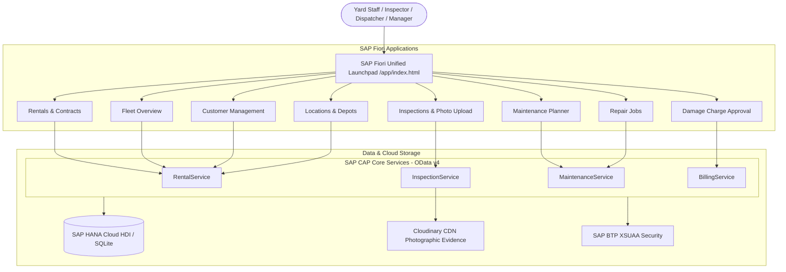

# 🚜 RETS - Rental Equipment Tracking System

[](https://cap.cloud.sap)
[](https://www.sap.com/products/technology-platform/hana.html)
[](https://experience.sap.com/fiori/)
[](https://cloudinary.com)
[](https://nodejs.org/)

An enterprise-grade **Rental Equipment Tracking and Lifecycle Management System** built on **SAP Cloud Application Programming Model (CAP)**, **SAP HANA Cloud**, and **SAP Fiori**. Designed for heavy machinery yards, equipment depots, and construction rental operations to streamline rental dispatch, automated check-in inspections, workshop repairs, and photographic damage billing.

---

## 📑 Table of Contents

- [Overview & Architecture](#-overview--architecture)
- [Key Features & Modules](#-key-features--modules)
- [Enterprise Tech Stack](#-enterprise-tech-stack)
- [Fiori Applications](#-fiori-applications)
- [OData Services & APIs](#-odata-services--apis)
- [Project Directory Structure](#-project-directory-structure)
- [Getting Started](#-getting-started)
  - [Prerequisites](#prerequisites)
  - [Environment Configuration](#environment-configuration)
  - [Installation & Local Run](#installation--local-run)
  - [Database Seeding](#database-seeding)
- [Photographic Evidence Integration (Cloudinary)](#-photographic-evidence-integration-cloudinary)
- [SAP BTP Deployment (MTA)](#-sap-btp-deployment-mta)
- [Security & Role-Based Access (RBAC)](#-security--role-based-access-rbac)

---

## 🏗 Overview & Architecture

RETS unifies yard logistics, customer rentals, equipment maintenance, and financial billing into a single reactive platform:



---

## ✨ Key Features & Modules

- **Fleet & Asset Tracking**: Monitor operational status (`Available`, `RentedOut`, `ReturnedPendingInspection`, `InRepair`, `Quarantined`) with telemetry, hours run, and GPS depot mapping.
- **Rental Contract Lifecycle**: Track reservations, active contracts, rental periods, extensions, and automated status transitions.
- **Digital Yard Inspections**: Standardized Check-In (Return) and Check-Out (Dispatch) workflows with condition grades (`Grade A` to `Grade D`) and component checklists.
- **Photographic Damage Evidence (FR-009)**: High-resolution photographic evidence upload powered by Cloudinary CDN, tied directly to condition logs and damage records.
- **Workshop Maintenance & Overhauls**: Preventive maintenance schedules, calibration triggers, corrective repair work orders, and technician assignments.
- **Damage Dispute & Billing Approval**: Transparent damage assessment, billing line items, manager approval gates, and customer invoicing status.

---

## 💻 Enterprise Tech Stack

| Layer | Technology | Details |
| :--- | :--- | :--- |
| **Backend Framework** | SAP CAP (`@sap/cds` v10) | Enterprise Node.js microservices with OData v4 protocol |
| **Persistence Layer** | SAP HANA Cloud / `@cap-js/hana` | Enterprise column-store DB with HDI container (SQLite for local dev) |
| **Frontend UI** | SAP Fiori Elements & Custom UI5 | Responsive Fiori design system with dynamic annotations and launchpad shell |
| **Media / CDN** | Cloudinary SDK (`cloudinary` v2) | Secure image storage, optimization, and transformation for damage proof |
| **Security & Auth** | SAP BTP XSUAA (`@sap/xssec` v4) | OAuth 2.0 / JWT role-based access control with granular scope mapping |
| **Packaging & CI/CD** | Cloud Foundry MTA (`mta.yaml`) | Multi-Target Application archive (`.mtar`) for SAP BTP Cloud Foundry deployment |

---

## 📱 Fiori Applications

The portal provides 8 specialized role-based applications under `app/`:

| App Path | Module Name | Primary Responsibilities |
| :--- | :--- | :--- |
| [`app/fleet-overview`](file:///c:/Users/admin/Desktop/SAP_SPRINT/app/fleet-overview) | **Fleet Overview** | Master equipment catalog, health meters, status filtering, category stats |
| [`app/rentals`](file:///c:/Users/admin/Desktop/SAP_SPRINT/app/rentals) | **Rentals** | Contract creation, item booking, customer assignment, dispatch validation |
| [`app/inspections`](file:///c:/Users/admin/Desktop/SAP_SPRINT/app/inspections) | **Inspections** | Return check-ins, pre-rental photos, damage identification, condition grading |
| [`app/maintenance-planner`](file:///c:/Users/admin/Desktop/SAP_SPRINT/app/maintenance-planner) | **Maintenance Planner** | Periodic safety inspections, preventative maintenance, calibration logs |
| [`app/repair-jobs`](file:///c:/Users/admin/Desktop/SAP_SPRINT/app/repair-jobs) | **Repair Jobs** | Workshop work orders, technician scheduling, replacement parts, labor hours |
| [`app/damage-charge-approval`](file:///c:/Users/admin/Desktop/SAP_SPRINT/app/damage-charge-approval) | **Charge Approval** | Damage cost calculation, billing disputes, manager approval workflow |
| [`app/customer-management`](file:///c:/Users/admin/Desktop/SAP_SPRINT/app/customer-management) | **Customers** | Client directory, authorized personnel contacts, active accounts |
| [`app/locations`](file:///c:/Users/admin/Desktop/SAP_SPRINT/app/locations) | **Locations & Yards** | Yards, depots, workshop facilities with geo-coordinates and plant codes |

Unified Launchpad available at: `http://localhost:4004/app/index.html`

---

## 🔌 OData Services & APIs

The backend exposes 4 modular OData v4 service endpoints:

- **`RentalService`** (`/odata/v4/rental`): Equipment catalog, customer accounts, contracts, items, and location depots.
- **`InspectionService`** (`/odata/v4/inspection`): Condition grading logs, photo evidence records, damage classification, and Cloudinary upload triggers.
- **`MaintenanceService`** (`/odata/v4/maintenance`): Preventative maintenance scheduling, workshop repair tickets, technician task lists.
- **`BillingService`** (`/odata/v4/billing`): Repair bills, damage charges, customer charge approval actions, pricing matrices.

---

## 📂 Project Directory Structure

```text
SAP_SPRINT/
├── app/                              # SAP Fiori frontend applications
│   ├── customer-management/          # Customer Directory Fiori App
│   ├── damage-charge-approval/       # Damage Billing & Approval Fiori App
│   ├── fleet-overview/               # Fleet & Equipment Health Fiori App
│   ├── inspections/                  # Yard Inspection & Photo Upload App
│   ├── locations/                    # Depot & Facility Management App
│   ├── maintenance-planner/          # Maintenance Scheduling App
│   ├── rentals/                      # Rental Contracts & Dispatch App
│   ├── repair-jobs/                  # Workshop Work Orders App
│   ├── fiori-auth.js                 # Role authentication & navigation script
│   └── index.html                    # Unified Fiori Launchpad Shell
├── db/
│   └── schema.cds                    # Core Domain Model (450+ lines CDL specification)
├── srv/
│   ├── billing-service/              # Billing & charge calculation services
│   ├── common/                       # Shared modules (Cloudinary CDN integration)
│   ├── inspection-service/           # Photographic inspection & grading logic
│   ├── maintenance-service/          # Maintenance order & repair logic
│   ├── rental-service/               # Rental contract & equipment state handlers
│   ├── index.cds                     # Unified service definitions
│   └── server.js                     # Custom CAP server bootstrap
├── scripts/
│   └── seed-data.js                  # Enterprise database seed script
├── .env.example                      # Template for environment variables & secrets
├── .gitignore                        # Comprehensive production Git ignore rules
├── mta.yaml                          # SAP Cloud Foundry Multi-Target Application descriptor
├── package.json                      # Project dependencies and CAP configuration
└── xs-security.json                  # SAP BTP XSUAA authorization roles & scopes
```

---

## 🚀 Getting Started

### Prerequisites

- **Node.js**: `v18.x` or `v20.x` LTS
- **SAP CDS DK**: Global CLI installed via `npm i -g @sap/cds-dk`
- **Cloud Foundry CLI & Make** (optional, for SAP BTP deployments)

### Environment Configuration

Create a local `.env` file based on [`.env.example`](file:///c:/Users/admin/Desktop/SAP_SPRINT/.env.example):

```powershell
cp .env.example .env
```

Add your Cloudinary credentials (required for photographic damage proof):

```ini
CLOUDINARY_URL=cloudinary://<api_key>:<api_secret>@<cloud_name>
```

> [!IMPORTANT]
> The `.env` file is protected by [`.gitignore`](file:///c:/Users/admin/Desktop/SAP_SPRINT/.gitignore) and will not be pushed to GitHub to safeguard API credentials.

### Installation & Local Run

1. **Install dependencies**:
   ```powershell
   npm install
   ```

2. **Start the local development server**:
   ```powershell
   npx cds-serve
   # or
   npx cds watch
   ```

3. **Access the application**:
   - **Fiori Launchpad**: [http://localhost:4004/app/index.html](http://localhost:4004/app/index.html)
   - **CAP Service Index**: [http://localhost:4004](http://localhost:4004)

### Database Seeding

To initialize the database with complete mock enterprise data (Customers, Equipment, Locations, Condition Logs, Rental Contracts):

```powershell
node scripts/seed-data.js
```

---

## 📸 Photographic Evidence Integration (Cloudinary)

During yard inspections (Check-In / Return from Rent), inspectors take photos of equipment condition and damage.

- **Storage**: Assets are streamed to Cloudinary CDN via [`srv/common/cloudinary.js`](file:///c:/Users/admin/Desktop/SAP_SPRINT/srv/common/cloudinary.js).
- **Metadata**: Each photo record stores secure URLs, public IDs, timestamps, damage classifications, and inspector identifiers in the `DamagePhotos` entity.
- **Audit Proof**: High-resolution photos provide dispute-proof verification for damage invoices.

---

## ☁ SAP BTP Deployment (MTA)

To deploy the solution to SAP Business Technology Platform (Cloud Foundry environment):

1. **Build the MTA archive**:
   ```powershell
   mbt build
   ```

2. **Deploy to SAP BTP space**:
   ```powershell
   cf deploy mta_archives/sprint_1.0.0.mtar
   ```

The MTA builds:
- **`sprint-srv`**: Node.js microservice runtime executing CAP handlers.
- **`sprint-db-deployer`**: HDI deployer applying table schemas and views to SAP HANA Cloud.
- **`sprint-auth`**: XSUAA service instance bound to the application roles.

---

## 🔐 Security & Role-Based Access (RBAC)

The application enforces role-based access control via [`xs-security.json`](file:///c:/Users/admin/Desktop/SAP_SPRINT/xs-security.json):

| Role / Scope | Description |
| :--- | :--- |
| `YardInspector` | Create and finalize check-in/check-out inspections, take photos |
| `RentalDispatcher` | Create rentals, assign equipment, manage customer contracts |
| `WorkshopTechnician` | Update repair orders, log labor, complete maintenance tasks |
| `BillingManager` | Review and approve damage charges, generate repair bills |
| `FleetAdmin` | Full administrative access to equipment, plants, and users |

---

## 📄 License & Maintainer

Maintained for **SAP Sprint Project** by **VasuPMen**.  
Built with ❤️ using the SAP Cloud Application Programming Model.
